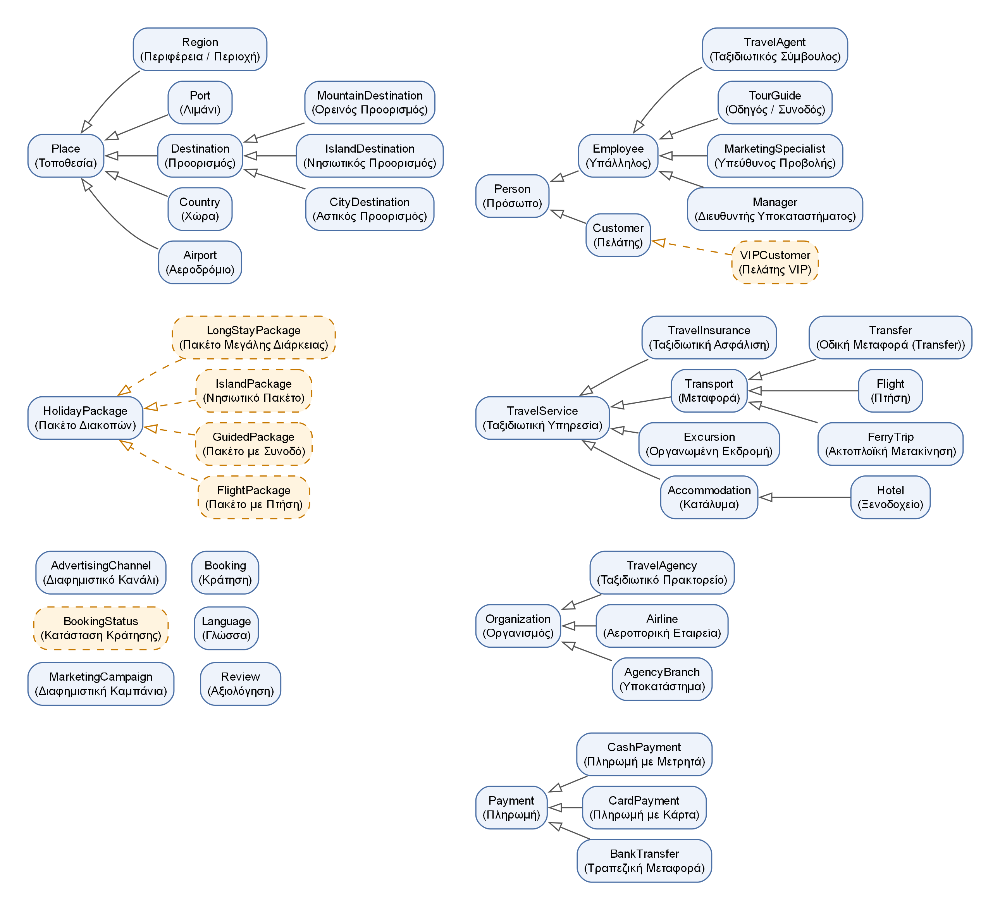

# Travel Agency Ontology: OWL 2 modelling and SPARQL

An OWL 2 ontology of a travel agency (destinations, holiday packages, hotels, flights, organised
excursions, guides, staff, customers, bookings, payments, reviews and advertising campaigns),
checked with the HermiT and Pellet reasoners and queried with SPARQL.

Coursework for *Semantic Web* (Σημασιολογικός Ιστός), Department of Information and
Electronic Engineering, International Hellenic University (IHU), 2026–27.

> **Για τον καθηγητή:** 1η εργασία (Οντολογική Μοντελοποίηση και SPARQL), θέμα 25
> «Οντολογική μοντελοποίηση ταξιδιωτικού πρακτορείου». Η αναφορά (πρότυπο IEEE) είναι στο
> `paper/paper.pdf`, η οντολογία στο `ontology/travel_agency.owl` και τα ερωτήματα στο
> `queries/`.

## Ontology at a glance

| | |
|---|---:|
| Classes | 45 (6 defined with `owl:equivalentClass`) |
| Object properties | 33 (7 inverse pairs, 1 transitive, 1 symmetric, 2 property chains) |
| Data properties | 22 |
| Named individuals | 117 |
| Reasoners | HermiT, Pellet 2.3.1: consistent, no unsatisfiable classes |
| Inferred facts (Pellet) | 97 |

Highlights:

- **Defined classes**, filled by the reasoner only: `VIPCustomer` (≥ 1000 loyalty points),
  `FlightPackage`, `IslandPackage`, `GuidedPackage`, `LongStayPackage` (≥ 7 days).
- **Transitive** `locatedIn` (Oia → Santorini → Cyclades → Greece) and the **property chain**
  `hasDestination ∘ locatedIn ⊑ visitsPlace`, so every package is linked to the countries it visits.
- **Property chain** `hasBooking ∘ handledBy ⊑ servedBy` (which travel agents served each customer).
- Qualified cardinalities, datatype restrictions (`rating` ∈ integer[1..5]), an enumerated class
  (`BookingStatus`), disjoint classes, `owl:AllDifferent`.
- Four **deliberate modelling errors** (`scripts/negative_tests.py`) are all detected by HermiT.

<p align="center">
  
</p>

## SPARQL queries

| Query | Features | Graph |
|---|---|---|
| Q1 package catalogue | multiple patterns, ORDER BY | asserted |
| Q2 flight packages under €1000 | FILTER, nested OPTIONAL, property path | asserted |
| Q3 revenue per package | COUNT, SUM, GROUP BY | asserted |
| Q4 best-rated packages | AVG, MIN, HAVING | asserted |
| Q5 staff a customer dealt with | UNION, BIND, IF/BOUND | asserted |
| Q6 promoted packages without sales | FILTER NOT EXISTS, GROUP_CONCAT | asserted |
| Q7 outstanding balances | BIND arithmetic, COALESCE, LANG | asserted |
| Q8 VIP customers and their agents | defined class, chain, inverse | inferred |
| Q9 packages per country | chain + transitive property | inferred |
| Q10 inferred package categories | VALUES, OPTIONAL | inferred |
| Q11 hotels in Greece | transitive property, `rdfs:subClassOf*` | inferred |

Q8, Q9 and Q11 return no rows on the asserted ontology; Q10 returns the packages without any
category. All results are in [`results/sparql_results.md`](results/sparql_results.md).

### Running the queries in Protégé

1. *File → Open* `ontology/travel_agency.owl` (Q1–Q7) or `ontology/travel_agency_inferred.owl` (Q8–Q11).
2. *Window → Tabs → SPARQL Query*, paste the query from `queries/` and press *Execute*.
3. For the reasoner check: *Reasoner → HermiT* (or Pellet) → *Start reasoner*.

`travel_agency_inferred.owl` is the ontology plus the facts inferred by Pellet, so the reasoning
queries give the same answers whether or not the SPARQL plugin takes the reasoner into account.

## How to run

Requires Python 3.10+ and Java (for HermiT/Pellet, bundled with owlready2). Graphviz is needed
only for the figures.

```bash
pip install -r requirements.txt
python scripts/build_owl.py        # ttl -> owl (RDF/XML) + results/ontology_stats.txt
python scripts/reason.py           # HermiT + Pellet -> results/reasoning_report.txt, inferred .owl
python scripts/negative_tests.py   # deliberate errors -> results/negative_tests.txt
python scripts/run_queries.py      # SPARQL -> results/sparql_results.md, results/sparql/*.csv
python scripts/diagrams.py         # figures -> paper/figures/
python scripts/make_submission.py  # moodle ZIP: Dagklis_Apostolos_2021031.zip
```

The source of the ontology is `ontology/travel_agency.ttl` (Turtle); `travel_agency.owl` is
generated from it and checked to contain exactly the same triples.

## Paper

`paper/paper.tex` is the report in IEEE conference format (Greek, LuaLaTeX); the compiled version is
`paper/paper.pdf`. To rebuild it, upload `paper/` to Overleaf and select the LuaLaTeX compiler.

## Structure

```
ontology/travel_agency.ttl           ontology source (Turtle)
ontology/travel_agency.owl           ontology for Protégé (RDF/XML)
ontology/travel_agency_inferred.owl  ontology + facts inferred by Pellet
queries/q01..q11_*.rq                SPARQL queries (all_queries.rq: all in one file)
scripts/                             build, reasoning, queries, figures, submission ZIP
results/                             reasoning report, error tests, query results
paper/                               paper.tex, paper.pdf and figures
```

## Author

Apostolos Dagklis (2021031), International Hellenic University
